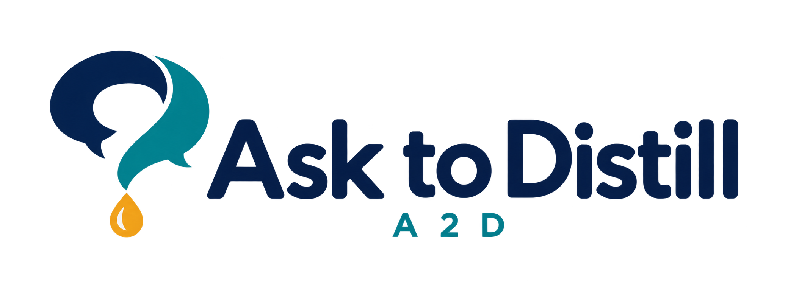
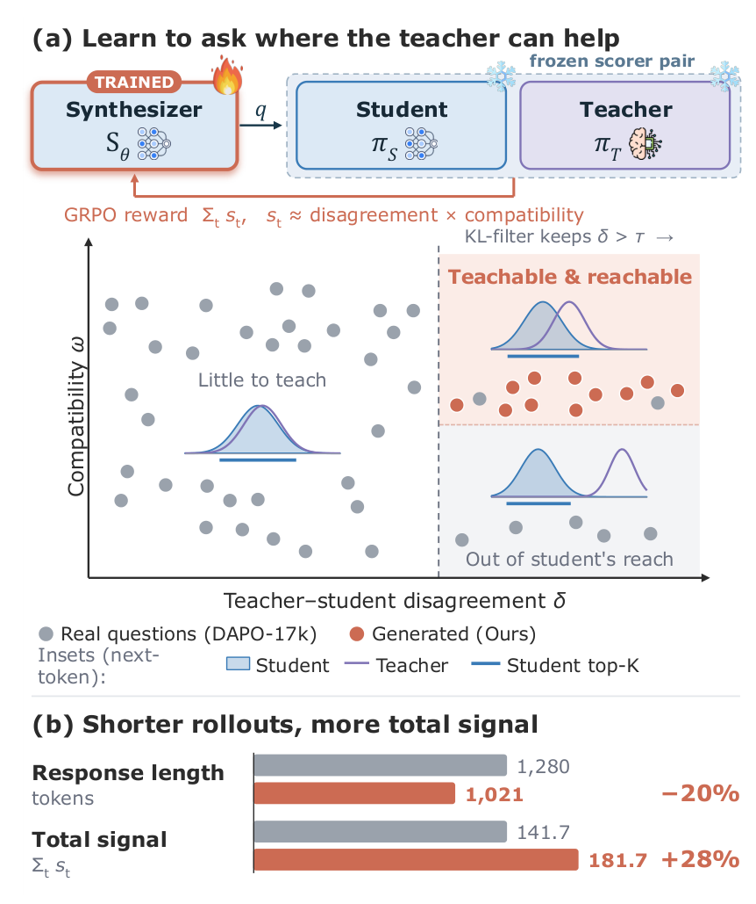
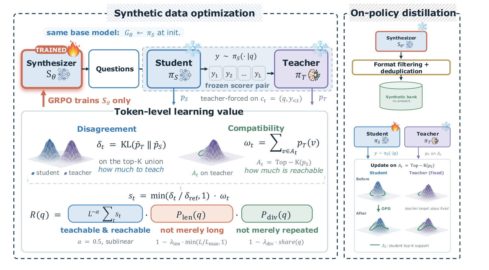
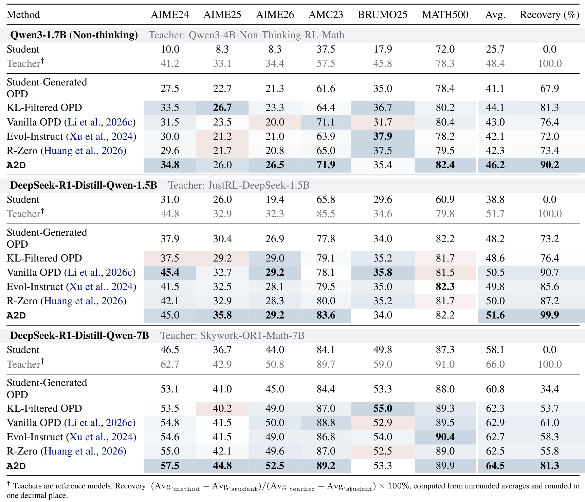
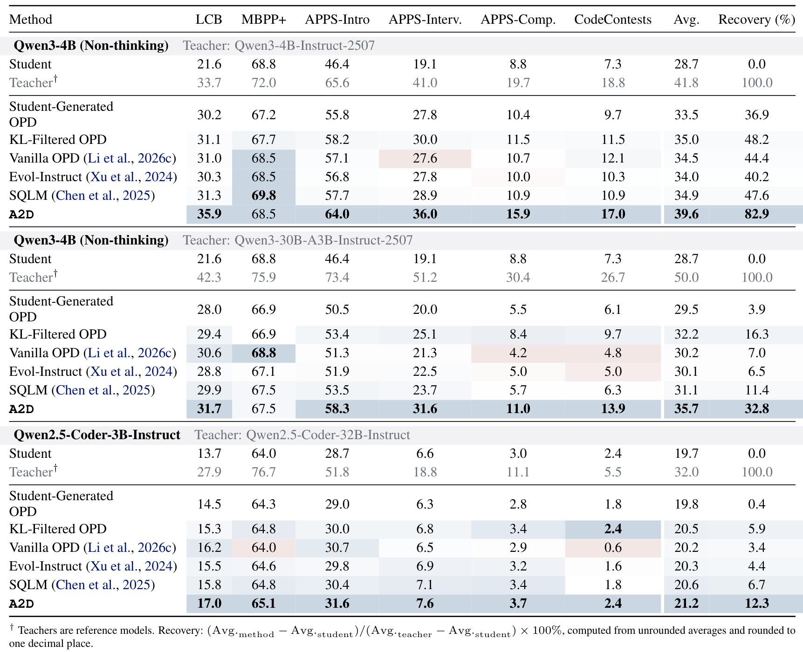
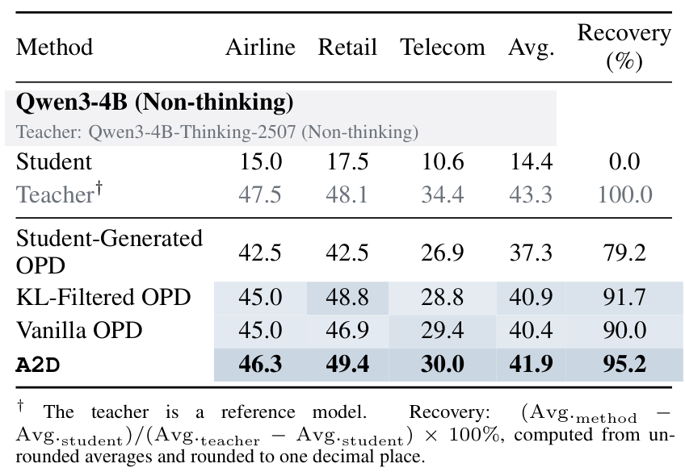

<a name="readme-top"></a>

<p align="center">
    
</p>

<h3 align="center">Learning to Synthesize Data for On-Policy Distillation</h3>

<p align="center">
    🤗 <a href="https://huggingface.co/collections/gasolsun/ask-to-distill-model-and-data-collection"><b>Models &amp; Data</b></a>
</p>

---

## Introduction

On-policy distillation (OPD) can succeed with surprisingly few training questions, which suggests
viewing questions as carriers of distributional knowledge transfer: a question decides which
trajectories the student generates and where the teacher's supervision becomes available.
**Ask-to-Distill (A2D)** builds such questions for a given student–teacher pair. A
student-initialized **synthesizer** is trained with reinforcement learning against the frozen
student and teacher, and its questions are filtered and deduplicated into a prompt-only bank for
standard OPD. Neither step needs ground-truth answers, reference solutions, external training
questions or auxiliary models; a frozen embedding model is used only for post-generation
deduplication.

<p align="center">
    
</p>

The synthesizer's reward is designed around what OPD can actually learn from:

- **Disagreement × compatibility.** Each token of the student's answer is scored by the
  teacher–student divergence (*how much to teach*), capped at a calibrated δ_ref, times the
  teacher's probability mass on the student's top-K candidates (*how much is reachable*).
  Disagreement outside the student's reach earns nothing.
- **Not merely long.** Sublinear length normalization and a soft response-budget penalty keep
  the synthesizer from inflating the reward with longer answers.
- **Not merely repeated.** A BLEU-based clustering penalty over every question scored in the same
  step keeps the synthesizer from collapsing onto a few questions.

```
calibrate δ_ref ──> synthesizer RL (GRPO on R(q)) ──> select a checkpoint ──> harvest ──> filter + dedup ──> bank ──> OPD ──> eval
```

We release code, banks and students for three domains:

- **Math** and **Code** — three student–teacher pairs each.
- **Agent (tau2-bench)** — the synthesizer writes executable task cards rewarded by the student's
  failure rate, and OPD runs on masked multi-turn episodes ([Agent-specific OPD](#agent-specific-opd)).

> <div align="center">
> <b>
> 🚨 Student and teacher must share one tokenizer: the reward and the OPD loss compare their next-token distributions index by index. Check this first (<a href="#prerequisites">Prerequisites</a>).
> </b>
> </div>

<details>
<summary><b>The reward and the pipeline in detail</b></summary>

<p align="center">
    
</p>

- **Reward** (paper §2.3). For a question q the frozen student π_S writes one solution of length
  L under the response budget L_max; student and teacher π_T are both evaluated on the same
  student-generated prefixes. At each position, δ_t is the KL divergence from the teacher to the
  student renormalised over the union of their top-K candidates (K = 16), and ω_t is the
  teacher's probability mass on the student's top-K. The token score is
  s_t = min(δ_t / (δ_ref + ε), 1) · ω_t, where δ_ref is the κ = 95th percentile of δ_t on
  N_cal = 200 questions of the untrained synthesizer. The question reward is
  R(q) = P_len(q) · P_div(q) · L^(−α) · Σ_t s_t, with P_len = 1 − λ_len · min(L / L_max, 1) and
  P_div = max(0, 1 − λ_div · share(q)), where share(q) is the size of q's cluster under
  average-linkage clustering (distance 1 − sentence BLEU, threshold τ) of all questions scored
  in the same synthesizer step.
- **Synthesizer RL.** GRPO with 8 instructions × 8 questions per step; each instruction names one
  topic of a curated list (`configs/topics/`), assigned by a seeded rotation.
- **Banks.** The chosen synthesizer checkpoint samples N questions; a format gate, token-set
  Jaccard deduplication (τ_lex) and greedy embedding deduplication (τ_sem, Qwen3-Embedding-4B)
  leave the bank.
- **OPD.** Top-16 OPD on the bank, `ground_truth = "N/A"`. The Vanilla baseline runs the same
  recipe on real questions (DAPO-Math-17k, OpenCodeReasoning, tau2-bench training tasks).

</details>

## Requirements

* Linux with CUDA 12.8 GPUs (developed on A100-80GB) and conda.
* Python `3.12`, PyTorch `2.8`, vLLM `0.11`, flash-attn `2.8.1`, and a vendored, patched
  [verl](https://github.com/volcengine/verl); all pinned in `env/requirements-a2d.lock.txt` and
  installed by one script.
* Compute: OPD uses one node of 8 GPUs; synthesizer RL uses 2 nodes × 8 GPUs by default (≤ 8 GPUs
  on one node also works); the tau2 OPD uses 2 nodes. Evaluation needs 1–2 GPUs.
* For tau2 only: a second conda env (`env/build_tau2_env.sh`) and an OpenAI API key with
  `gpt-4o-mini` and `gpt-5` access for the user simulator and evaluation.
* Optional: SLURM. Every stage also runs as a plain `a2d` command inside an allocation.

> <div align="center">
> <b>
> 🚨 OPD runs in fp32: checkpoints of one arm take hundreds of GB. Point <code>A2D_CKPT</code> at a large disk before training.
> </b>
> </div>

## Installation

```bash
git clone https://github.com/GasolSun36/Ask_to_Distill.git
cd Ask_to_Distill

# CUDA 12.8 toolchain from conda; flash-attn prebuilt wheel (fallback: env/build_flash_attn.sh)
bash env/build_a2d_env.sh            # conda env "a2d": torch 2.8, vLLM 0.11, verl (vendored), a2d CLI
bash env/build_tau2_env.sh           # only for tau2; prints the A2D_TAU2_PYTHON to export
conda activate a2d
python env/check_env.py --stage imports   # versions vs the lock (CPU); --stage core|verl|vllm on a GPU

# where data, models, checkpoints and outputs live (defaults are under the repository)
cp configs/paths.example.env configs/paths.env && $EDITOR configs/paths.env && source configs/paths.env
```

`build_a2d_env.sh` installs the package editable, which provides the `a2d` command. In an existing
environment that has the locked dependencies, `PYTHONPATH=<repo>/third_party/verl:<repo> python -m
ask2distill.cli ...` is the same command without installing anything.

## Quick Start

Each stage is one `a2d` command (`a2d --help` lists them), and `--dry-run` prints the resolved
configuration, the environment and the exact command without running anything. On SLURM, fill in
`launchers/slurm/cluster.env` from its example and submit with `launchers/slurm/submit.sh <stage>
<pair>`; inside an existing allocation, call `a2d <command> --pair <pair>` directly. The released
banks are the OPD default, so the quick start begins at OPD. In the commands below, `<N>` is the
OPD checkpoint step to evaluate.

### 1. Download models and data

```bash
a2d models download --pair Math_Qwen3-1.7B_Qwen3-4B-Non-Thinking-RL-Math-Step500   # --all for every pair; --modelscope if the HF CDN is blocked
a2d models syn-nothink --pair Math_DeepSeek-R1-Distill-Qwen-1.5B_JustRL-DeepSeek-1.5B   # the two Math_DeepSeek-* pairs only: their synthesizer bases
a2d data download                    # banks (gasolsun/<pair>) + auxiliary files (gasolsun/Ask_to_Distill-data), md5-verified
a2d data eval                        # every math / code test set (gasolsun/Ask_to_Distill-eval)
a2d data build math                  # DAPO-Math-17k (Vanilla math arm)
a2d data build ocr                   # OpenCodeReasoning at a pinned revision (~9 GB) ...
a2d data build code-real             # ... and its seeded 10k subset, the Vanilla code arm
a2d data build tau2                  # tau2 domain data, official split (incl. the Vanilla agent arm), domain context
```

The synthetic banks are the HF datasets `gasolsun/<pair>`; `a2d data download` fetches them at
pinned revisions together with the small auxiliary release (δ_ref records, the tau2
synthesizer-RL prompts and task-card pools) and checks every file against `data/MANIFEST.json`.
The real-question training sets are not redistributed: `a2d data build` converts the originals --
[DAPO-Math-17k](https://huggingface.co/datasets/BytedTsinghua-SIA/DAPO-Math-17k) (deduplicated on
the prompt, with the DAPO instruction tail), [OpenCodeReasoning](https://huggingface.co/datasets/nvidia/OpenCodeReasoning)
(the seeded 10k selection) and the official [tau2-bench](https://github.com/sierra-research/tau2-bench)
training split -- into the format the Vanilla arms train on. docs/DATA.md lists what is fetched
from where, every pinned revision, the licenses, and how to work offline or where the HF file CDN
is blocked (`--from-dir`, `--banks-dir`).

### 2. Distill a math or code student

**Math** (any `Math_*` pair; the commands below use the Qwen3 pair):

```bash
P=Math_Qwen3-1.7B_Qwen3-4B-Non-Thinking-RL-Math-Step500
a2d opd --pair $P --arm ours --dry-run          # print the exact verl command first
launchers/slurm/submit.sh opd $P --arm ours     # or `a2d opd --pair $P --arm ours` on an 8-GPU node
a2d eval math --pair $P --arm ours --step <N>   # merges global_step_<N>, then avg@16 on 6 tasks
a2d collect math --runs $A2D_OUT/eval/math/opd_${P}_ours_step<N>
```

**Code** (any `Code_*` pair):

```bash
P=Code_Qwen3-4B_Qwen3-4B-Instruct-2507
launchers/slurm/submit.sh opd $P --arm ours
launchers/slurm/submit.sh eval-code $P --arm ours --step <N>  # LCB + EvalPlus + APPS / CodeContests
a2d collect code --runs $A2D_OUT/eval/code/opd_${P}_ours_step<N>
```

### 3. Distill a tau2-bench agent

Needs the tau2 env, `A2D_TAU2_PYTHON`, and an OpenAI key in `A2D_OPENAI_ENV_FILE` with
`gpt-4o-mini` and `gpt-5` access (docs/TAU2.md):

```bash
P=Agent_Qwen3-4B_Qwen3-4B-Thinking-2507
launchers/slurm/submit.sh tau2-opd $P --arm ours                  # 2 nodes: trainer + user simulator
a2d merge --pair $P --arm ours --step <N> --chat-template student  # compute node
a2d tau2 serve --pair $P --plan eval --arm ours --step <N> --out $A2D_OUT/tau2/eval_endpoints.txt
a2d tau2 eval --pair $P --endpoints $A2D_OUT/tau2/eval_endpoints.txt --tag test4   # login node
a2d tau2 summarize --pair $P --models $P-ours-s<N>
```

### 4. Run the full pipeline

The stages before OPD (calibration, synthesizer RL, selection, harvest, filter, bank) are in
docs/PIPELINE.md, with one command and one `submit.sh` stage per step. To build a bank for a new
pair, see [Using your own student–teacher pair](#using-your-own-studentteacher-pair).

## Released Models and Data

A pair is named `<Domain>_<Student>_<Teacher>`; the name is its config file
(`configs/pairs/<pair>.yaml`), the `--pair` argument, the name of its bank, and the name of its
HuggingFace repositories (`gasolsun/<pair>`: the OPD student and the synthetic question bank).

| Pair (`--pair`) | Domain | Student | Teacher |
|---|---|---|---|
| `Math_Qwen3-1.7B_Qwen3-4B-Non-Thinking-RL-Math-Step500` | math | `Qwen/Qwen3-1.7B` | `Keven16/Qwen3-4B-Non-Thinking-RL-Math-Step500` |
| `Math_DeepSeek-R1-Distill-Qwen-1.5B_JustRL-DeepSeek-1.5B` | math | `deepseek-ai/DeepSeek-R1-Distill-Qwen-1.5B` | `hbx/JustRL-DeepSeek-1.5B` |
| `Math_DeepSeek-R1-Distill-Qwen-7B_Skywork-OR1-Math-7B` | math | `deepseek-ai/DeepSeek-R1-Distill-Qwen-7B` | `Skywork/Skywork-OR1-Math-7B` |
| `Code_Qwen3-4B_Qwen3-30B-A3B-Instruct-2507` | code | `Qwen/Qwen3-4B` | `Qwen/Qwen3-30B-A3B-Instruct-2507` |
| `Code_Qwen2.5-Coder-3B-Instruct_Qwen2.5-Coder-32B-Instruct` | code | `Qwen/Qwen2.5-Coder-3B-Instruct` | `Qwen/Qwen2.5-Coder-32B-Instruct` |
| `Code_Qwen3-4B_Qwen3-4B-Instruct-2507` | code | `Qwen/Qwen3-4B` | `Qwen/Qwen3-4B-Instruct-2507` |
| `Agent_Qwen3-4B_Qwen3-4B-Thinking-2507` | tau2-bench | `Qwen/Qwen3-4B` | `Qwen/Qwen3-4B-Thinking-2507` |

## Evaluation

The released students evaluate straight from the Hub. `--model` takes an HF repo id (or a local
HF directory), downloads it once to `$A2D_MODELS/gasolsun__<pair>`, and for `gasolsun/<pair>`
picks the pair's evaluation settings by itself, so no `--pair` is needed.

```bash
# evaluation data (once): every math and code test set, from gasolsun/Ask_to_Distill-eval
a2d data eval

# all math students: 6 tasks, avg@16 (MATH500 avg@4), one GPU per task
for P in Math_Qwen3-1.7B_Qwen3-4B-Non-Thinking-RL-Math-Step500 \
         Math_DeepSeek-R1-Distill-Qwen-1.5B_JustRL-DeepSeek-1.5B \
         Math_DeepSeek-R1-Distill-Qwen-7B_Skywork-OR1-Math-7B; do
    a2d eval math --model gasolsun/$P
done
a2d collect math             # one row per finished run, with avg6

# all code students: LiveCodeBench + EvalPlus + APPS / CodeContests, 2 GPUs (TP 2)
for P in Code_Qwen3-4B_Qwen3-30B-A3B-Instruct-2507 \
         Code_Qwen2.5-Coder-3B-Instruct_Qwen2.5-Coder-32B-Instruct \
         Code_Qwen3-4B_Qwen3-4B-Instruct-2507; do
    a2d eval code --model gasolsun/$P
done
a2d collect code             # one row per finished run, with Avg
```

`a2d data eval` fetches [Ask_to_Distill-eval](https://huggingface.co/datasets/gasolsun/Ask_to_Distill-eval)
at a pinned revision, where every test set is stored in one format together with the exact prompt
it is evaluated with, and writes the files the evaluators read. AMC23 and LiveCodeBench are not
rehosted and come from their original repositories at pinned revisions. Each file is checked
against the md5 of the copy behind the paper's numbers.

Results land in `$A2D_OUT/eval/{math,code}/gasolsun__<pair>/`; each `a2d eval` also prints its
row when it finishes, and a killed run resumes where it stopped. Any other model with a pair's
chat template is evaluated the same way: `a2d eval math --pair <pair> --model <repo id or dir>`.
On SLURM, run the loop inside an allocation, or submit `launchers/slurm/submit.sh eval-math` /
`eval-code` for OPD checkpoints of your own (`--arm A --step N`). The tau2 agent is served and
evaluated separately (docs/TAU2.md).

avg6 = mean of AIME24, AIME25, AIME26, AMC23, BRUMO25, MATH500; code Avg = mean of LCB v5_v6,
MBPP+ (lenient), APPS introductory / interview1k / competition and CodeContests, taken as in the
paper table: each score rounded to one decimal, the cells averaged and printed with one decimal;
`a2d collect code` also prints the mean of the unrounded scores. tau2 pass^1 is reported per
domain (airline, retail, telecom) and as their unweighted mean. docs/REPRODUCE_MAIN_TABLE.md gives
every row's commands.

## Performance

We compare A2D with OPD on unoptimized student-generated questions, KL-filtered real questions,
real-bank (Vanilla) OPD and other synthetic-data methods, on six math benchmarks, six code
benchmarks and the three tau2-bench domains. A2D has the highest average score among the OPD
methods for all seven student–teacher pairs. Recovery is the share of the student–teacher gap
closed: (Avg_method − Avg_student) / (Avg_teacher − Avg_student).

### Mathematical reasoning

<p align="center">
    
</p>

### Code generation

<p align="center">
    
</p>

### Agentic tasks (tau2-bench)

<p align="center">
    
</p>

## Agent-specific OPD

The tau2 OPD arms use the same OPD objective as math and code -- top-16 student support, reverse
KL weighted by the renormalised student probabilities, the per-token signal used directly as the
advantage (`token_reward_direct`), the same learning rate and fp32 precision -- applied to a
**masked multi-turn trajectory**. It is not a different loss; three things are agent-specific:

1. **Multi-turn masked distillation.** An episode interleaves the student's turns (replies and
   tool calls), tool outputs from the tau2 environment and simulated-user turns. Only tokens the
   student generated get `response_mask = 1`; tool outputs and user-simulator text are context
   with mask 0. Both the OPD advantage and the loss are multiplied by the mask, and the
   token-mean normaliser counts only policy tokens:

   ```
   L = (1 / sum_t m_t) * sum_t m_t * l_t^OPD,      m_t = 1[token t generated by the student]
   ```

   where `l_t^OPD` is the per-token top-16 OPD term used for math and code. Environment and user
   text conditions both models but is never treated as student-teacher disagreement.
2. **Stop-on-repeat.** If the student's reply near-duplicates its previous reply, that turn is
   removed from the sequence and the mask and the episode ends, which keeps a small model's
   degenerate repetition loops out of training.
3. **Budgets and frozen services.** One 8,192-token response budget is shared by all turns, with
   at most 20 assistant turns; the user simulator (Qwen3-4B-Instruct-2507, temperature 1.0, 512
   tokens per turn) and the tau2 environment run as external frozen services.

The rollout is built by `ask2distill/tau2/trainside/agent_loop.py`; the settings are under `opd`
in `configs/base/tau2.yaml`. docs/TAU2.md explains why the mask and the stop are needed.

## Using your own student–teacher pair

Everything below runs for a math or code pair; a new pair is one YAML file plus the commands of
the pipeline. The template `configs/pairs/TEMPLATE_custom.yaml` is fully commented and
`tests/unit/test_custom_pair.py` checks that a pair filled in from it dry-runs every stage.

### Prerequisites

- **One tokenizer.** δ_t and ω_t compare the two models' next-token distributions index by index,
  and the OPD loss reads the teacher's probabilities at the student's top-K token ids, so student
  and teacher must share the vocabulary (the synthesizer is a copy of the student and shares it
  too). Output heads padded to different sizes are fine (both are cut to the common size before
  the softmax). Check before anything else:

  ```bash
  python - "$A2D_MODELS/MyStudent" "$A2D_MODELS/MyTeacher" <<'PY'
  import sys
  from transformers import AutoTokenizer
  s, t = (AutoTokenizer.from_pretrained(p) for p in sys.argv[1:])
  assert s.get_vocab() == t.get_vocab(), "different vocabularies: not a valid pair"
  text = "Let f(x) = x^2 + 1. Find f(3).\n```python\nprint(input())\n```"
  assert s(text)["input_ids"] == t(text)["input_ids"]
  print("shared vocabulary:", len(s), "tokens; eos", s.eos_token, "/", t.eos_token)
  PY
  ```

- **Chat template and thinking control.** Every prompt is rendered with the student's chat
  template, and the teacher is scored on that same token sequence. For a hybrid Qwen3 student
  held in non-thinking mode set `models.qwen3_nothink: true` (every template call gets
  `enable_thinking=False`) and `opd.chat_template_args: "+data.apply_chat_template_kwargs.enable_thinking=False"`.
  A student whose template always opens a `<think>` block (DeepSeek-R1-Distill style) would spend
  the synthesizer's question budget thinking: give the synthesizer a no-think copy whose
  generation prefix closes the block immediately -- `a2d models syn-nothink --pair P` builds
  `<student>-SynNoThink` (weights symlinked, only the chat template's generation prefix patched)
  for templates with the DeepSeek-R1-Distill prefix; set `models.syn_nothink: true` and
  `models.synthesizer_init: ${paths.models}/<student>-SynNoThink`. For another template family,
  make the same edit to a copy of the student's `chat_template` by hand.
- **Domain base.** Start from the math bases (`configs/base/math.yaml`, `configs/base/eval_math.yaml`;
  questions with one final answer, solved with a `\boxed{}` hint) or the code bases
  (`configs/base/code.yaml`, `configs/base/eval_code.yaml`; stdin/stdout programming problems in
  the LiveCodeBench template). The template uses the math bases and marks every line to change
  for code with `CODE:`. A new domain needs code (see [Adding a domain](#adding-a-domain)).

### Step by step

1. **Configure the pair.**
   `cp configs/pairs/TEMPLATE_custom.yaml configs/pairs/Math_MyStudent_MyTeacher.yaml`, set
   `pair:` to the file name and fill every `FILL` value: `models.student` / `models.teacher`
   (local HF directories under `$A2D_MODELS`; `models.hf` pins them for `a2d models download`),
   `models.qwen3_nothink`, `opd.chat_template_args`, `bank.row_id_prefix`. Lengths come from the
   domain base: the student's response budget L_max is `opd.max_response_length` and must equal
   `reward.max_new` and `calib.max_new` (7,168 math, 4,096 code); the synthesizer's question
   budget L_q is `synrl.max_response_length` (4,096 math, 2,048 code). `a2d calibrate --pair P
   --dry-run` (and the same for every later stage) checks the file; it warns while
   `reward.delta_ref` is unset.
2. **Data.** `a2d data build math` (or `a2d data build code-eval` for code) writes the evaluation
   sets; the math OPD launcher also loads AIME24 / AIME25 / AMC23 as (never scored) validation
   files. A Vanilla baseline needs `a2d data build math` or `a2d data build ocr` +
   `a2d data build code-real`.
3. **Calibrate δ_ref.** `a2d calibrate --pair P` samples N_cal = `calib.n_questions` (200)
   questions from the initial synthesizer (`models.synthesizer_init`) under the synthesizer-RL
   prompt, lets the student answer each once under L_max, teacher-forces both models and writes
   `$A2D_OUT/P/calib/calib_delta_ref.json` (κ = `calib.percentile`, 95). Copy its
   `delta_ref_rounded` into `reward.delta_ref` (and `calib.expected_delta_ref`). One GPU holds
   student and teacher for small pairs; for a teacher above ~30B set `calib.teacher_device: cuda:1`
   and run on two GPUs (`launchers/slurm/submit.sh calibrate P` asks for two for code pairs).
4. **Reward knobs** (`reward.*`; the paper symbol in brackets). The domain bases hold the values
   used for the paper's pairs:

   | Key | Math | Code | Meaning |
   |---|---|---|---|
   | `len_alpha` (α) | 0.5 | 1.0 | R_raw = Σ_t s_t / L^α; 1 = per-token mean |
   | `len_pen` (λ_len) | 0.3 | 0.0 | P_len = 1 − λ_len · min(L / L_max, 1) |
   | `trunc_zero` | false | true | a truncated rollout is scored on its prefix (false) or dropped from the question's mean (true) |
   | `rolls` | 1 | 2 | student rollouts per question (the reward is their mean) |
   | `topk` (K) | 16 | 16 | candidate support of δ_t and ω_t |
   | `diversity.mode` | `bleu` | `bleu` | `bleu`: 1 − sentence BLEU over the full step (paper); `emb`: Qwen3-Embedding cosine per group of `diversity.group` rows of a reward rank |
   | `diversity.thresh` (τ) | 0.1 | 0.1 | average-linkage distance threshold |
   | `diversity.pen` (λ_div) | 1.0 | 1.0 | P_div = max(0, 1 − λ_div · share) |

   Code solutions are short or loop until the cap, which a soft length penalty cannot separate,
   hence α = 1, λ_len = 0 and truncated rollouts dropped; for a reasoning domain with long but
   finite solutions, keep the math values.
5. **Synthesizer RL.** `a2d synrl --pair P` (SLURM: `launchers/slurm/submit.sh synrl P`, then
   `launchers/slurm/resubmit.sh` across wall-clock windows) builds the topic-rotated instruction
   parquet (`synrl.prompts`, from `synrl.topics` and `synrl.prompt_seed`) if it does not exist yet
   and trains S_θ with GRPO: 60 steps of 8 instructions × g = 8 questions (64 scored per step),
   learning rate 1e-6, entropy 0.01, KL 0.005, rollout temperature 1.0, a checkpoint every 5
   steps (`synrl.*`, paper Appendix A.2). Edit `configs/topics/<domain>.yaml` (or point
   `synrl.topics` at your own list) to steer the question distribution.
   - *Layout.* `synrl.layout` places S_θ on `actor_gpus` GPUs and the frozen student + teacher on
     a separate reward pool of `reward_gpus` × `reward_nnodes` GPUs (default 8 + 8 on two
     nodes). Each reward rank holds a full bf16 copy of student and teacher, so the two must fit on
     one GPU together with the student's generation KV cache. The 64 questions of a step must
     split evenly over the reward ranks; in `bleu` mode the ranks exchange the question texts so
     the share always covers the whole step.
   - *Fewer GPUs.* With up to 8 GPUs in total, everything runs on one node with a private Ray
     head (e.g. `synrl.layout.actor_gpus=4 synrl.layout.reward_gpus=4`); `configs/smoke/*.yaml`
     shows a 1 + 1 GPU layout with a smaller synthesizer.
   - *Memory.* `synrl.offload` (actor parameters and optimizer on the CPU; needed for a ≥ 4B
     synthesizer in fp32), `synrl.gpu_memory_utilization` (the vLLM rollout's share of an actor
     GPU), `synrl.ppo_max_token_len_per_gpu` / `synrl.max_num_batched_tokens`, and on the reward
     side `reward.gen_bs` (questions per generation call: bounds the KV cache next to a large
     teacher). `a2d synrl --pair P --dry-run` prints a rough per-GPU estimate.
6. **Choose the synthesizer checkpoint.** `a2d select sweep --pair P` merges and samples every saved
   checkpoint, `a2d select pick --pair P` applies the diversity gate (mean cosine, effective
   clusters), the reward gate and picks the lowest mean cosine (`$A2D_OUT/P/pick.json`). Set
   `select.chosen_step` to the reported step (`select.yield` optionally compares the saturation
   yield of a few candidates).
7. **Harvest.** `a2d harvest --pair P` samples `harvest.shards` × `harvest.per_shard` raw questions
   (N; 16 × 5,000 = 80,000 in the template), one shard per GPU job (`--shard i`). The bank has
   `bank.n` questions: plan it as (OPD steps) × 64, the OPD batch, per epoch.
8. **Filter and deduplicate.** `a2d filter --pair P` runs, per slice of shards (`filter.slices`),
   the format gate (malformed, self-talk, answer leakage, missing context; for code, no Input /
   Output specification or a shipped solution), the token-set Jaccard pass at
   τ_lex = `filter.jaccard` (0.7) and the greedy embedding pass at τ_sem = `filter.sat_thr` (0.95);
   with several slices `a2d aggregate --pair P` deduplicates across them (`filter.agg_thr`, in
   `filter.agg_order`). `a2d bank --pair P` writes the first `bank.n` survivors as the OPD parquet
   `$A2D_OUT/P/banks/P.parquet`.
9. **OPD.** `a2d opd --pair P --arm ours` (8 GPUs; `launchers/slurm/submit.sh opd P --arm ours`)
   trains the original student on the bank (`opd.arms.ours.train: ${bank.out}`), with the method
   constants of `configs/base/opd.yaml`. Choose the checkpoint to report on a **held-out
   validation set** (for example a split of real questions you set aside, evaluated at every
   saved step), not on the test benchmarks.
10. **Evaluate.** `a2d eval math --pair P --arm ours --step N` or `a2d eval code ...` merges the
    checkpoint and evaluates it; `a2d collect math|code --runs DIR` writes the table.

Minimal command sequence for a math pair `P` (code: `a2d aggregate` after `a2d filter`, `eval code`):

```bash
P=Math_MyStudent_MyTeacher                      # configs/pairs/$P.yaml, from the template
a2d models download --pair $P && a2d data build math
a2d calibrate --pair $P                         # -> reward.delta_ref
a2d synrl --pair $P                             # 2 x 8 GPUs by default
a2d select sweep --pair $P && a2d select pick --pair $P   # -> select.chosen_step
a2d harvest --pair $P && a2d filter --pair $P && a2d bank --pair $P
a2d opd --pair $P --arm ours
a2d eval math --pair $P --arm ours --step <N> && a2d collect math --runs $A2D_OUT/eval/math/opd_${P}_ours_step<N>
```

### Sanity checks and pitfalls

- **δ_ref.** In `calib_delta_ref.json`, p50 is near 0 and the 95th percentile clearly positive. A
  δ_ref near 0 means the two models barely disagree (little to distil, or the teacher is the
  student); a very large one, or `n_tokens` far below N_cal × typical solution length, points at a
  tokenizer or chat-template mismatch. During RL, `synrm/delta_mean` should stay on the scale of
  δ_ref.
- **Reward collapse.** The reward worker logs `synrm/*` per step (`$A2D_OUT/P/synrl/synrl_dump_<exp>.jsonl.metrics.r*`)
  and every scored question with its reward (`...jsonl.r*`). `synrm/parsed_frac` (share of
  questions that were solved and scored) falling, or `synrm/R_raw` climbing while the questions
  in the dump degenerate (empty, truncated, a solution instead of a question), is reward hacking:
  stop and inspect the dump.
- **Synthesizer entropy and repetition.** `actor/entropy` in the trainer log, `synrm/sem_uniq`
  (share of questions not within Jaccard 0.6 of an earlier one), `synrm/mean_sim` (mean pairwise
  BLEU similarity of the step) and `synrm/cluster_share`. Falling entropy with rising similarity
  is collapse onto a few questions; the pick's diversity gate rejects such checkpoints, but a
  run that collapses early wastes the remaining steps.
- **Truncation.** `synrm/len_frac` (mean L / L_max) near 1 means most solutions hit the budget: the
  reward then mostly scores prefixes (math) or drops the question (code). Raise L_max (and OPD's
  budget with it, then recalibrate) or make the topics easier.
- **Filter yield.** `$A2D_OUT/P/filter/sat.s<k>.json` records raw → format → Jaccard → embedding
  counts. A low format share means the synthesizer writes solutions or commentary (check the
  dump); a low embedding share means repetition, so a larger harvest will not grow the bank.

### Adding a domain

A domain is a solve template, a synthesizer prompt with a topic list, a format filter, a bank
format and an evaluator:

- **prompts**: `ask2distill/common/prompts_<domain>.py` with `synthesizer_messages(topic)` and the
  solve template, registered in `ask2distill/synrl/solve.py` (`SOLVE_TEMPLATES`) and
  `ask2distill/harvest/sampling.py` (`synthesizer_messages`); a topic list
  `configs/topics/<domain>.yaml`;
- **filter**: `ask2distill/filter/<domain>_filter.py` with `comp_filter` / `strong_filter`, wired
  into `ask2distill/filter/saturation.py` (`domain_filters`);
- **bank**: the row format in `ask2distill/bank/build_bank.py` (`TEMPLATES`, `bank_rows`);
- **config**: `configs/base/<domain>.yaml` (start from `configs/base/math.yaml`) and the domain in
  `ask2distill/config.py` (`DOMAINS`, `SECTIONS`, `DOMAIN_BASES`), the reward domain check in
  `ask2distill/synrl/reward_config.py`;
- **evaluation**: an `a2d eval <domain>` command in `ask2distill/cli.py` and its evaluator under
  `ask2distill/eval/`.

The reward itself (δ_t, ω_t, s_t, R(q)) is domain-independent.


## Repository Layout

| Path | Contents |
|---|---|
| `ask2distill/` | the package: `calib` (δ_ref), `synrl` (synthesizer RL and its reward worker), `select`, `harvest`, `filter`, `bank`, `opd`, `merge`, `eval`, `tau2`, `data`, shared `common` code; CLI `a2d` |
| `configs/` | per-pair YAML; `base/`, `pairs/` (with `TEMPLATE_custom.yaml`), `topics/`, `smoke/` |
| `launchers/` | `local/run_stage.sh`; `slurm/` batch scripts, `submit.sh`, `resubmit.sh` |
| `env/` | locked requirements and build scripts for the two conda environments |
| `third_party/` | vendored, patched copies of verl, LiveCodeBench, EvalPlus and ToolOrchestra's tau2-bench (THIRD_PARTY.md) |
| `data/MANIFEST.json` | md5 / size / rows / license / source of every downloaded file and of the files built from public sources (the only data in git) |
| `tests/` | unit tests, GPU checks (`equiv`), 2-GPU smoke scripts |
| `docs/` | the documentation below |

Documentation:

- [docs/PIPELINE.md](docs/PIPELINE.md): every stage, its command, inputs, outputs and resources.
- [docs/CONFIG.md](docs/CONFIG.md): how configurations compose; every key with its value.
- [docs/REPRODUCE_MAIN_TABLE.md](docs/REPRODUCE_MAIN_TABLE.md): commands to evaluate and retrain each row.
- [docs/DEVIATIONS.md](docs/DEVIATIONS.md): implementation details kept on purpose, and open points.
- [docs/DATA.md](docs/DATA.md): data sources, the release, licenses, pins, offline workflows.
- [docs/TAU2.md](docs/TAU2.md): the agent pipeline, two environments, serving, agent-specific OPD, evaluation.
- [THIRD_PARTY.md](THIRD_PARTY.md): vendored code, upstream commits, our modifications.

## Acknowledgements

Our training code is built on [Rethinking-OPD](https://github.com/Thinking-Space/Rethinking-OPD)
(formerly thunlp/OPD) and its fork of [verl](https://github.com/volcengine/verl); the top-k
on-policy distillation, the teacher worker and the per-token loss come from there. We thank the
authors for releasing their code. Our changes to it are listed in THIRD_PARTY.md. We also thank
the maintainers of [vLLM](https://github.com/vllm-project/vllm),
[LiveCodeBench](https://github.com/LiveCodeBench/LiveCodeBench),
[EvalPlus](https://github.com/evalplus/evalplus), [tau2-bench](https://github.com/sierra-research/tau2-bench)
and [ToolOrchestra](https://github.com/NVlabs/ToolOrchestra), which we use for serving and evaluation.

## License

The code in this repository is released under the Apache License 2.0 (LICENSE). Vendored
third-party code keeps its own license (THIRD_PARTY.md); downloaded data files carry per-file
licenses (docs/DATA.md).

<p align="right" style="font-size: 14px; color: #555; margin-top: 20px;">
    <a href="#readme-top" style="text-decoration: none; color: #007bff; font-weight: bold;">
        ↑ Back to Top ↑
    </a>
</p>
